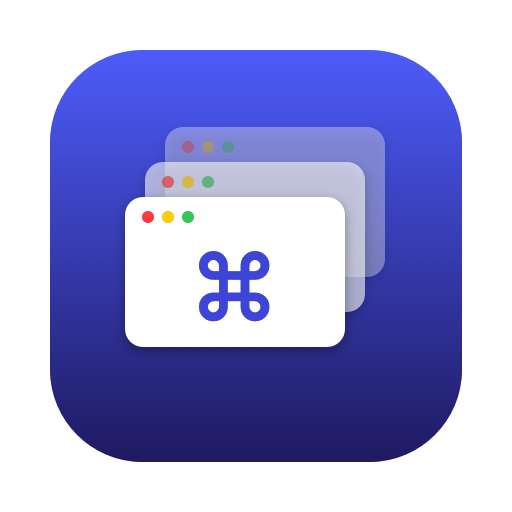

<p align="center"></p>

# Flipane

**⌘Tab that switches windows, not apps.**

macOS's ⌘Tab jumps between apps, then leaves you hunting for the right window. Flipane replaces
it with a switcher that lists every window, most recently used first, so two Safari windows are
two entries and one keystroke takes you straight to either.

It looks like the system switcher: a row of app icons on Liquid Glass, sized, spaced and scaled
to match it, with the selected window's title underneath.

It lives in the menu bar, has no dock icon, and gives ⌘Tab back to the system when it quits.

## Using it

| Keys | Action |
| --- | --- |
| ⌘Tab | Open the switcher on the previous window; keep ⌘ held |
| Tab / ⇧Tab | Next / previous window |
| ← → ↑ ↓ | Move the selection |
| Release ⌘ or Return | Switch to the selected window |
| Esc | Cancel |
| ⇧⌘Tab | Open the switcher going backwards |
| Point / click | Select / switch to a window |

Minimized windows and windows of hidden apps are left out.

### Menu bar options

- **Windows on All Displays**: off by default, so only windows on the display under the mouse are listed.
- **Windows on All Desktops**: off by default, so only the current desktop (Space) is listed. When on,
  picking a window on another desktop switches you there.
- **Launch at Login**
- **Accessibility Settings…**

## Requirements

- macOS 27 or later
- Swift 6.3 or later, from Xcode or the Command Line Tools (`xcode-select --install`)

## Install

There is no prebuilt download; both ways below build it from source on your Mac.

### Homebrew

```sh
brew install alxrxs/tap/flipane
ln -sfn "$(brew --prefix)/opt/flipane/Flipane.app" /Applications/Flipane.app
open /Applications/Flipane.app
```

Homebrew signs it ad-hoc, so after each `brew upgrade` remove Flipane from the Accessibility list
and grant it again.

### From source

```sh
git clone https://github.com/alxrxs/flipane.git
cd flipane
./build.sh install
```

This builds a release copy, puts it at `/Applications/Flipane.app` and launches it. On first launch
macOS asks for **Accessibility** permission; Flipane needs it to intercept ⌘Tab and to see and raise
windows. Grant it in System Settings → Privacy & Security → Accessibility, and Flipane starts working
without a relaunch.

`./build.sh` on its own only builds `build/Flipane.app`.

**Signing:** `build.sh` signs with your first *Apple Development* certificate if you have one (a
free Apple ID in Xcode is enough), or `CODESIGN_IDENTITY` if you set it. Without one it falls back to
an ad-hoc signature, which works, but macOS treats every rebuild as a new app and you have to
re-grant Accessibility each time.

### Uninstall

Quit Flipane from its menu, delete `/Applications/Flipane.app` (and `brew uninstall flipane` if you
used Homebrew), and remove it from the Accessibility
list in System Settings. ⌘Tab goes back to the system switcher as soon as Flipane quits.

## Caveats

- **Private APIs.** macOS has no public way to disable the built-in ⌘Tab, focus one specific window
  of an app, or reach windows on other desktops, so Flipane uses undocumented system calls for these.
  A macOS update can break them. Each one is looked up at runtime, so a missing one degrades that
  feature instead of crashing. This also means Flipane can never be on the App Store.
- **If Flipane crashes**, the system ⌘Tab stays disabled until you relaunch Flipane or log out.
  Quitting normally, `kill`, and logging out all restore it.
- **Windows on All Desktops** has to probe each app to find windows on other desktops. It gives up
  after 0.1 s per app, so a window in a very busy app can occasionally be missing.

## Development

```sh
swift build        # debug build
swift test         # unit tests (FlipaneCore: key routing, selection, window filtering)
./build.sh install # build, install to /Applications and relaunch
```

`Sources/FlipaneCore` holds the pure, tested logic; `Sources/Flipane` is the app (event tap,
window list, panel, activation). The icon is drawn by `scripts/make-icon.swift`.

Releases are tagged `vX.Y.Z`; `build.sh` stamps the latest tag into the app's version and the
commit count into its build number.

## License

[GPL-3.0](LICENSE). Copyright © 2026 Andrei.
